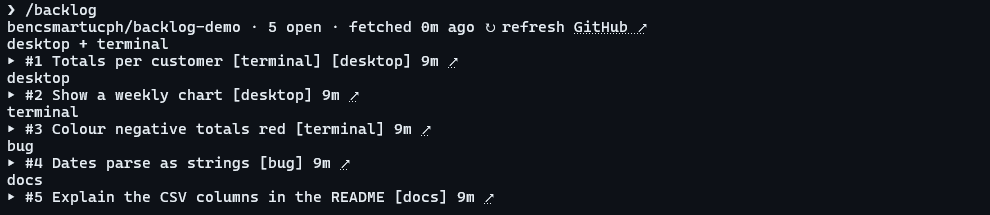

# backlog

`/backlog [label]` shows the current repo's open GitHub issues as a working board, so you can pick the next thing to do without leaving Claude Code.



- On the desktop app it draws a board of cards; in the terminal, a list.
- Issues labelled `desktop` or `terminal` get columns of their own; the rest are grouped by their first label, unlabelled last. `/backlog bug` shows only issues labelled `bug`.
- Each issue links to GitHub. Press one to read its first lines, then **work on it** to put "Work on owner/repo#12: title" in the prompt box.
- **↻** fetches the list again in place. Nothing refreshes on its own.
- Claude gets a short text version too (one line per issue, no bodies), so you can say "take the oldest bug".

Needs the [GitHub CLI](https://cli.github.com/) (`gh`), signed in. Any repo `gh` can see works, private ones included. Outside a GitHub repo, or when GitHub doesn't answer, it says which in one line.

**Status:** the terminal list has been run live; the desktop board has passed its tests but I haven't yet seen it live.

## Install

```
claude plugin marketplace add bencsmartucph/ben-mods
claude plugin install backlog@ben-mods
```
