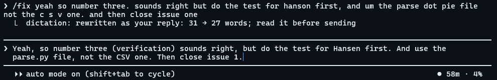

# dictation

`/fix <text>` rewrites a dictated reply so Claude reads it the way you meant it, using the conversation it belongs to.



Voice dictation mishears names, breaks sentences in odd places, and loses track of which question you are answering. `/fix` hands your text to a fork of the current conversation as a side task with one job: rewrite, never answer. Because the fork has the whole conversation in view, it can:

- fix misheard words, including names and terms that only make sense in this conversation;
- put your answers in Claude's order, numbered the way Claude numbered its questions;
- name what "number six" or "the second one" points at, in brackets after your reference;
- cut filler and false starts, without adding anything you didn't say.

The result goes into the prompt box for you to read before sending; the line after it says how many words changed. If the reply looks like an answer rather than a rewrite, your text is left as dictated. With no argument, `/fix` rewrites whatever is in the prompt box.

`TERMS` in `hooks/register.ts` is my own vocabulary (names, tools, known mishearings). Replace it with yours.

**Status:** used live in the terminal (the screenshot above); unit tests pass. Each `/fix` is one forked model call, so it costs about as much as a short turn.

## Install

```
claude plugin marketplace add bencsmartucph/ben-mods
claude plugin install dictation@ben-mods
```
